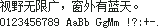
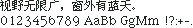

# 中文点阵字样

收集中文点阵字形，记录来源、尺寸与提取方法。

**[在线浏览](https://fonts.resmx.com/)** · [GitHub Pages](https://legendtired.github.io/chinese-bitmap-specimens/) · [研究记录](docs/research-notes.md) · [提供线索](CONTRIBUTING.md)

## 字样

### 方正像素 12×12



### Mac OS / Ikarus Kai 12×12



### Sony G90


## 目录

当前 **203 个条目**：202 个原生、设计格点或设备字样，1 个参考资料图。固定字框高度为 8–64px。

- 原生字样按原尺寸和整数倍显示，可筛选、收藏和对比。
- 来源、版本、字符覆盖和许可见各条目详情。
- 同尺寸的近似版本选取代表展示，保留其他来源。
- 资料图和不定字框单独标记。缺字留空。
- 收藏保存在当前浏览器。

## 获取字库

- [字体获取与导出](docs/font-export.md)：按输入格式查找方法与限制。
- [Panasonic FS-UV1 / FS-A1F 16点](docs/panasonic-fs-uv1.md)：校验ROM后导出Unicode BDF。

- [文曲星 NC1020 12点](docs/nc1020.md)：下载来源镜像，用脚本提取为 BDF。
- [Casio Ex-word 12／24点](docs/casio-exword.md)：下载 CJF，用脚本转换为 BDF。12点列为推荐。
- 其他条目的获取入口见网站详情。

本站提供固定字样和提取工具。字体使用与再分发按原来源许可执行。

## 资料

- [研究方法](docs/methodology.md) · [研究记录](docs/research-notes.md)
- [目录数据](data/catalog.json) · [统计](data/summary.json)
- [v16](docs/release-v16.md) · [v17](docs/release-v17.md) · [当前状态](docs/PROJECT_STATE.md)
- [贡献指南](CONTRIBUTING.md) · [第三方声明](third_party/README.md)

## 本地维护

直接打开 `index.html` 即可浏览。维护需要 Python 3.9+ 和 Node.js 18+：

```sh
python3 scripts/workspace.py build
python3 scripts/workspace.py check
```

目录单源为 `data/catalog.json`。原字体、ROM 和研究输入放在被忽略的 `local-research/`，不随网站发布。详见[开发说明](docs/DEVELOPMENT.md)与[部署说明](docs/deployment.md)。
