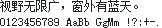
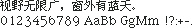

# 中文点阵字样

收集、展示与研究中文点阵字形的资料档案。

这里关注的不只是“像素风格”，而是字体在有限像素网格上的具体设计，以及这些字形来自哪里、如何保存、有哪些已知边界。网站是浏览与比较资料的入口，仓库同时保存字样目录、来源线索、收录原则与研究记录。

**[在线浏览中文点阵字样](https://legendtired.github.io/chinese-bitmap-specimens/)** · [研究记录](docs/research-notes.md) · [贡献线索](CONTRIBUTING.md)

## 项目缘起

中文点阵字体的资料往往年代久远，散落在旧网站、论坛帖子、软件档案和设备文档中。有些链接已经失效，有些只留下零碎线索。随着内容逐渐迁入相对封闭的移动应用，以及大量 AI 生成内容涌入搜索结果，寻找原始资料、辨别信息来源，也变得更加费时。

这个项目希望把这些分散的线索重新整理起来：展示真实字样，记录原生尺寸与来源，区分已经核实的事实和尚待确认的推测。它不追求收录数量，也不只是一个展示网站，而是一份可以持续补充、纠正和追溯的中文点阵字体资料档案。

希望后来感兴趣的人，不必从头重复同样的搜索，也让这些曾经出现在屏幕上的字形与设计，留下更容易查找的记录。

## 想做什么

- 把分散在字体项目、历史系统和设备资料中的点阵字样整理到一起，减少重复寻找和核验。
- 用固定 PNG 展示实际来源中的字形；原生字样保留原尺寸与整数倍率，参考资料图则明确标注来源类型和未核定边界。
- 记录来源、版本、原生设计证据、缺字和许可线索，区分已经核实与尚待确认的部分。
- 保留有代表性的设计，不以重复版本或未经调校的普通矢量取模扩充数量。

## 字样一瞥

以下为目录中的实际 PNG，不是用现代字体模拟的设计稿。图片保留原始尺寸；可在网站中放大、对比并查看对应来源。

### 方正像素 12×12



### Mac OS / Ikarus Kai 楷体原生点阵 12×12



### Sony G90 原字模对照


OSD 示例只代表来源中已核验的设备字符，不等于完整通用中文字库；其解码与实机验证边界见条目详情及[研究记录](docs/research-notes.md)。

## 收录原则

优先收录有原生像素设计依据、笔画清晰且有代表性的字样。文件扩展名不是判断依据：字体可以保存在 BDF、内嵌位图表中，也可以用轮廓文件封装真正的像素设计。

不将普通矢量字体在任意字号上的栅格化结果自动视为原生点阵。未经像素级调整、明显残缺、难以辨认或证据不足的样张可以暂不收录。“疑似取模”不等于已经证明；未收录也不构成对原作价值的否定。

同尺寸高度雷同的版本尽量合并为代表条目，并保留相关来源。已核验样文一致，不代表完整字库相同，更不代表作者或许可相同。

## 来源与证据

每项的来源、提取方式、版本、覆盖范围、许可线索和不确定性保存在[目录数据](data/catalog.json)中，也可在网站详情中阅读。

- 作者或官方项目有助于核对设计意图和许可。
- 原始文件及内嵌位图表可以证明所提取像素的来源，但不能单独证明所有字形均为手工设计。
- 历史镜像可提供版本线索，不等于官方来源或开放授权。
- 设备文档网格重建、ROM 解码与实机画面核验是不同证据层级，不混为一谈。

具体做法见[研究方法](docs/methodology.md)。

## 当前范围与局限

当前目录有 **201 个条目**：200 个原生／设计格点或来源限定字样、1 个参考资料图。这不是 201 套独立完整字库，也不把同家族字号、派生版本或截图表现简单计作新家族。新增范围与去重说明见 [v17 收录说明](docs/release-v17.md)。

固定字框的原生字高目前为 8–64px。Pixels Han 两款是实际格点设计，但没有可诚实归一的固定字框，独立归入“不定字框”；设计 em 不等于统一字高。资料图未实测的原格仍归入“未核定”，不能拿 PNG 宽高当字体大小。

普通原生样文中，中文完整 191 项、缺字 5 项。具备普通 ASCII 样文的 180 项中完整绘出 175 项、未完整绘出 5 项（其中1项为原字有形但不满足精确格点条件，非原库缺字）；另外 16 项为全角英数或原中文字库不含 ASCII，不计作 ASCII 完整。4 项设备来源限定样张及 1 项资料图不参与这些普通样文统计。缺字不借其他字体补齐，覆盖结论不外推完整字库。

历史制作过程、授权链与完整字符集仍有待核项目；真实位图存储不自动证明每字手绘。来源为镜像时与原作者发布区分，预览不授予字体使用许可。

收藏仅保存在当前浏览器中，不会跨设备同步；清除浏览器数据会丢失收藏。

## 贡献

欢迎通过 [Issue](https://github.com/legendtired/chinese-bitmap-specimens/issues) 提供字体、历史设备字模、原始资料和勘误线索，也欢迎 [PR](https://github.com/legendtired/chinese-bitmap-specimens/pulls)。请附原始来源、作者与版本、原生尺寸、设计依据和许可线索；完整要求见 [CONTRIBUTING.md](CONTRIBUTING.md)。

不需要先提交完整字体文件才能提供线索。请勿上传未经授权的字体、ROM、固件或字模数据。

## 资料导航

- [研究方法与核验边界](docs/methodology.md)
- [研究记录](docs/research-notes.md)
- [贡献指南](CONTRIBUTING.md)
- [目录数据](data/catalog.json)与[统计](data/summary.json)
- [固定字样图](assets/specimens/)与[独立资料页](fonts/)
- [本地开发入口](docs/DEVELOPMENT.md)、[项目状态](docs/PROJECT_STATE.md)与 [AGENTS.md](AGENTS.md)
- [本地浏览与部署](docs/deployment.md)
- [第三方素材说明](third_party/README.md)

## 本地维护

克隆或下载仓库后，直接打开 `index.html` 即可浏览，无需安装依赖或启动服务器。

修改界面、编辑目录和重新生成静态资料页不需要原始字库。维护工具需要 Python 3.9+ 和 Node.js 18+：

```sh
python3 scripts/workspace.py build
python3 scripts/workspace.py check
```

仓库不附带原始字体、ROM 或本地研究资料。重新绘制样图需要自行核实来源与许可，并准备对应输入；本地研究文件放在被 Git 忽略的 `local-research/` 中，不应上传到公开仓库。具体流程见[开发说明](docs/DEVELOPMENT.md)。

## 权利与许可

仓库仅展示固定 PNG 字样、来源信息及研究说明，不分发完整字体或 ROM。公开可见、可获取或可预览并不意味着可以自由使用或再分发；预览不授予字体使用许可。使用原字体前，应核实对应来源的适用许可。

本项目不以统一的 MIT 等许可覆盖第三方字体、字样和资料。第三方组件按各自许可保留声明；说明按钮的 Lucide 图标使用 ISC 许可，见[第三方说明](third_party/README.md)。
