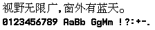

# Samsung SGH-R208 原生16×16点阵

本条目对应 SGH-R208 的 R20ZCVI1 固件，内嵌构建日期为 **2002-09-06**。汉字为原生16×16位图，西文为同一固件内已证实配对的8×16位图。只发布固定研究样图、聚合核验结果和不含字模的离线脚本，不分发完整字体或固件。

来源是第三方保存的历史固件，不是本次实机转储；固定样图是静态重建，不是手机截图。原生位图存储已确认，不等于已证明字体最初作者、逐点手绘过程或开放许可。

## 来源、版本与权利边界

- [Samsung SGH-R系列第三方存档资料页](https://archive.org/details/samsung-sgh-r-220)。外层 `Samsung SGH-R Series.7z` 中定位 `SGH-R208/R20ZCVI1.7z`，再取得对应的 AXF、OGM 两个文件。存档页的R220标题不改变已核成员的R208身份。
- [2001-12-11北京晚报的R208报道，新浪转载](https://tech.sina.com.cn/it/t/2001-12-11/95620.shtml) 仅佐证型号历史，不用2001年的机型报道替代本次字体载体的2002年日期。
- AXF `0x4E6C` 保存 `Sep 06 2002`，同一开头构建标识附近有 `16:50:10`。日期是固件构建记录，不是字体最早设计年份。

| 输入 | 字节数 | SHA256 |
| --- | ---: | --- |
| Samsung SGH-R Series.7z | 6630529 | `5c5b7c3d75de9e9fa15163ce1bed8ee92ee6c8c3fbc2396834a0fcaca5effd7a` |
| SGH-R208/R20ZCVI1.7z | 1713630 | `2e8389bdea672ae542b255274461452854fd115e189693955a5694e13f0a0223` |
| R20ZCVI1.axf | 1976056 | `4c8d54f97d2c05f34b8cf9995fad1a4ba75fbb942c8dd8b49602fb70e931d521` |
| R20ZCVI1.ogm | 1178788 | `a7f2e4bd228b31937eb0ad47170592a1ec21b35801ae2086c00e9be686dab629` |

Samsung／第三方固件及字模未查到开放再分发或商用许可。第三方公开存档不等于授权，请自行确认取得、处理和使用来源材料所需的权利。不公开原ROM、AXF、OGM、完整BDF、字模JSON或全字库子集。本项目提供的是有限固定预览和源方法，不替权利人授予使用许可。所有处理均为静态数据读取，**不要运行包内刷机程序或固件**。

## 已核字库范围

- OGM `0xAD7E..0x127BA` 是排序的小端16位Unicode表，共 **15,646条源记录**。
- 位图区从 `0x127BA` 开始，每槽32字节。最后一槽U+9FA6为空fallback，不计为支持字符；支持的非空汉字为 **15,645个**。
- 全部 **6,763个GB2312汉字** 均存在且非空，还包含部分繁体。这个结论不代表GB2312全部7,445个汉字及符号均已核实，也不代表完整GBK、Big5或GB18030。
- 每个16×16字模分两页，每页8行，横坐标依字节递增，每字节bit 0在该页最上方。只转换位序表达，不缩放、平滑、细化、裁白边或补字。
- 同一AXF中的 Western index 4 为 **8×16**，每字符16字节。指针表 `0x1868C0` 的第4项指向 `0x17EEC0`；宽、高、字节步长表分别位于 `0x158610`、`0x158604`、`0x15861C`。可打印ASCII U+0020–U+007E共95项，其中空格是原空槽，其余均非空。

符号仅明确导出以下两项，不把其他未核范围补入：

1. **U+3002「。」**：OGM `0x8CB7A` 的16项查找表中索引2，对应位图 `0x8CBDA`，16×16。AXF `0x3FE20..0x3FE6C` 是该区间已核读取路径；该renderer还存在其他符号分支，本导出器不声称完整复刻。
2. **U+FF0C「，」**：AXF `0x4041E..0x4042E` 将低字节加字面值A120，得到内部A12C；`0x405C8..0x405CE` 选择 Western index 4，`0x405DC..0x405F4` 将该记录交给Latin字形路径。它实际使用 **8×16 ASCII逗号**，保留8px宽，不人为添加全角空白。此码位与U+002C为同字模的两个已核Unicode映射。

AXF `0x3FC44` 路径从所选宽度表读取尺寸，并在 `0x3FD90..0x3FD96` 返回该宽度。本样图的西文及逗号8px依据这条路径，不是跨来源任意配字。固件还有其他Western字体，其他UI上下文可能选择不同字体；本资料没有证明全部界面只用index 4。原机整体排版、基线与所有分支的advance未完整核定。

## 离线重绘与可选本地BDF

[`scripts/samsung_r208_bitmap_export.py`](../scripts/samsung_r208_bitmap_export.py) 只依赖Python标准库。为安全处理路径，它要求POSIX系统的 `O_NOFOLLOW`、目录描述符及排他创建能力；不支持这些能力的系统会停止。无网络访问、无固件执行、无矢量渲染、无内嵌原字模。

先创建一个可信、本地、没有符号链接的父目录。`--output` 目标目录必须尚不存在；脚本不覆盖或合并现有目录，也不自动创建父目录。

```sh
mkdir -p local-research/generated
python3 scripts/samsung_r208_bitmap_export.py \
  local-research/samsung-r208/R20ZCVI1.axf \
  local-research/samsung-r208/R20ZCVI1.ogm \
  --output local-research/generated/r208
```

默认只写两项：固定 `samsung_r208_16.png` 与聚合 `samsung-r208-report.json`。读入前检查普通文件和精确长度，读取后校验SHA；完整解码和输出内容在写入前准备好。所有路径拒绝符号链接，输出目录及各文件排他创建，输入错误或路径冲突不会留下部分结果；可捕获的写入错误会回滚本次输出。进程被强制杀死或硬件故障不属于可保证回滚的范围。

在已具备相应使用权时，可加 `--export-bdf`，在新目录中额外生成 `samsung-r208-local-only.bdf`。**该完整BDF仅供本地使用，不加入仓库或网站。**

BDF共 **15,742个Unicode映射项**：15,645汉字＋95 ASCII＋U+3002＋U+FF0C。这里的“映射项”不是15,742个独立设计：逗号有上述两个Unicode别名。空fallback不导出。BDF采用显式的上对齐存储框约定，left=0、bottom=0、ascent=16、descent=0，保留8/16px字宽与原像素，不冒称原机基线。`SIZE 16 75 75` 对应 `SWIDTH=width×72000÷(16×75)`，16宽为960、8宽为480。

## 固定样图



- 中文：`视野无限广，窗外有蓝天。`，宽184px，含8px逗号。
- 西文：`0123456789 AaBb GgMm !?:+-.`，27字符，宽216px。
- 合图 **224×44px**，外边4px、两行之间4px，不额外插入字间距。未把字框归一化或缩放。
- PNG SHA256：`3c907fb8750476b2c59015ea73da90cac2cfafb291b2a2e1bb20bb20402b6b13`。

此PNG与初次研究确认的RGB样图逐像素相同；新文件为纯标准库灰度PNG，文件编码与原RGB文件不同，不用文件字节差异冒充像素变化。

## 独立源核验与测试

独立验证器 [`scripts/verify_samsung_r208_bitmap_decode.py`](../scripts/verify_samsung_r208_bitmap_decode.py) 不调用被测解码函数生成参考。已对15,646个Han源槽、95个ASCII及period槽逐源位重解并重打包原字节，核对全部6,763个GB汉字、空fallback、短Thumb指令及PC相对字面值。15,742项BDF在内存中由独立文本解析器读回，尺寸、SWIDTH和每个像素全部一致。固定PNG全部9,856个像素与独立源布局及初次研究图一致。

聚合结果见 [`data/samsung-r208-independent-audit.json`](../data/samsung-r208-independent-audit.json)，绑定提取器和验证器的SHA，不包含完整字模。验证器使用可信本地路径，不声称拥有提取器同等级的敌对路径防护。

```sh
python3 tests/samsung-r208.test.py
SAMSUNG_R208_AXF=local-research/samsung-r208/R20ZCVI1.axf \
SAMSUNG_R208_OGM=local-research/samsung-r208/R20ZCVI1.ogm \
python3 tests/samsung-r208.test.py
```

无私有源时检查合成位序、尺寸、BDF度量、固定PNG SHA、坏输入、拒覆盖、符号链接和写入失败回滚；源核验测试明确跳过。提供两个精确源文件时才运行全覆盖、SHA变异拒绝与CLI精确重绘。可另外以可信原研究PNG运行独立验证，审计输出必须是新文件：

```sh
python3 scripts/verify_samsung_r208_bitmap_decode.py \
  local-research/samsung-r208/R20ZCVI1.axf \
  local-research/samsung-r208/R20ZCVI1.ogm \
  --research-png local-research/samsung-r208/reviewed-native.png \
  --audit local-research/generated/r208-independent.json
```

## 与现有及历史字库比较

聚合结果见 [`data/samsung-r208-dedup-audit.json`](../data/samsung-r208-dedup-audit.json)。比较同Unicode的完整矩阵，另仅删除全空外围行列后比较，不缩放、不平滑、不剪墨迹、不做简繁替换。未映射记录不进入分母，不能当作不相同。

- 旧224条样图全部重新核对SHA；223条可比较样图各存在同字像素差异，ChinaSea参考资料图不适用。这是样字筛查，不是224份全字库核验。
- 历史恢复源221份，结合原始Big5、DEC及GB12345补查，共216个参考ID至少有可信汉字子集可按Unicode比较，不等于每项全部记录均已映射。124份含部分未编码记录；HZK16F、Sony raw-pattern的完整同字映射仍未核，不能标为通过。
- 最大大分母精确裁边重合为Beijing16：803/6763（11.873429%），整框520；HZK16和ISAS Fangsong16各268/6763裁边、171整框。NISC16仅37/6763裁边相同。
- 补核DEC24、DEC32可信子集，对R208各为0/13060裁边相同。CCLIBF16严格排除原来源警告的六个换位风险码及其他缺口后，为1/6757。没有把GB12345无条件套成GB2312。
- 当前新增5项另从固定SHA原输入重解，覆盖旧样图基线之外的Windows13／20、PS2与Sunplus两款：Windows13裁边1/6763、Windows20为0/6763；PS2为0/15645；Sunplus16×16、20×24各0/6763。五组整框相同均0，并用独立字符串矩阵裁边算法复算一致。

上述低精确重合不证明原创、手绘、独立设计谱系或再分发权利，也不排除非精确改造。历史参考集合含已撤项目，核验它们不意味着重新收录。本批只增加获准的R208一项，其余候选不随之发布。
